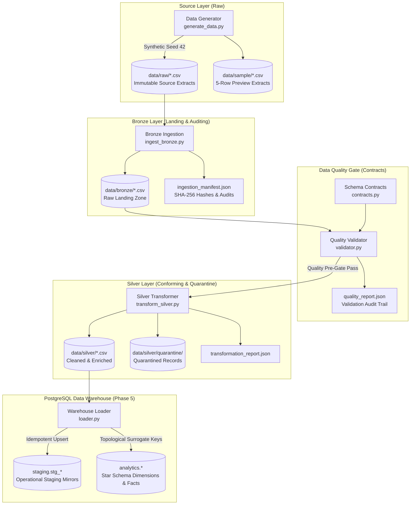
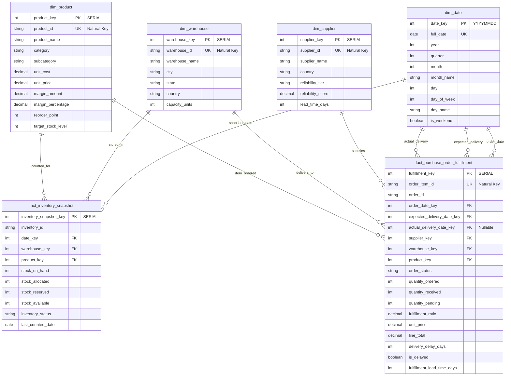

# RetailFlow: Enterprise Retail Supply Chain Data Engineering Pipeline

RetailFlow is an end-to-end, production-grade data engineering platform designed to process, ingest, validate, transform, and model retail supply chain and inventory operations. Built around the **Medallion Architecture**, the platform provides deterministic data quality contracts, quarantine management for corrupt data, and an analytical PostgreSQL Data Warehouse with an enterprise star schema for supply chain analytics.

---

## Business Problem & Analytical Focus

Modern retail supply chains face critical operational challenges:
* **Inventory Stockout & Capital Inefficiency**: Holding excess slow-moving inventory ties up working capital, while stockouts lead to lost revenue and customer churn.
* **Supplier Lead-Time Reliability**: Variations in supplier fulfillment times disrupt scheduled warehouse intake and fulfillment SLAs.
* **Fulfillment Bottlenecks**: Delays between purchase order placement, delivery, and receiving directly impact regional fulfillment centers.

RetailFlow tracks purchase orders, line-item fulfillment, warehouse capacity utilization, and periodic inventory snapshots to deliver high-visibility metrics across multi-facility retail networks.

---

## Medallion Architecture & Data Flow



### Pipeline Progression:
1. **Raw (Source)**: Immutable CSV extracts representing suppliers, warehouses, product catalog, inventory levels, purchase orders, and line items.
2. **Bronze (Landing Zone)**: Raw-fidelity verbatim landing zone with automated audit manifests, byte-size audits, and SHA-256 cryptographic verification.
3. **Data Quality & Contracts Gate**: Formal contract enforcement validating data types, primary key uniqueness, foreign key validity, and retail business logic rules.
4. **Silver (Conformed Layer)**: Standardized casing and whitespace, parsed dates, rounded financials, derived lead-time/delay metrics, deterministic deduplication, and isolated quarantine for conflicting records.
5. **Gold / Warehouse Layer**: Persistent PostgreSQL data warehouse featuring an operational `staging` schema and an analytical dimensional `analytics` star schema.

---

## Project Structure

```text
retailflow-data-engineering/
├── data/
│   ├── raw/                        # Phase 1: Immutable source CSV extracts
│   │   ├── suppliers.csv
│   │   ├── warehouses.csv
│   │   ├── products.csv
│   │   ├── inventory.csv
│   │   ├── purchase_orders.csv
│   │   └── purchase_order_items.csv
│   ├── sample/                     # 5-row preview extracts
│   ├── bronze/                     # Phase 2: Raw-fidelity landing zone
│   │   ├── ingestion_manifest.json # Audit metadata manifest & SHA-256 hashes
│   │   ├── quality_report.json     # Phase 3: Data quality audit report
│   │   └── *.csv                   # Exact bronze verbatim copies
│   └── silver/                     # Phase 4: Conformed Silver layer
│       ├── quarantine/             # Preserved rejected/conflicting records
│       │   └── *_quarantine.json
│       ├── transformation_report.json # Detailed transformation audit log
│       └── *.csv                   # Conformed, standardized, enriched datasets
├── sql/
│   ├── schema/                     # Phase 5: DDL scripts for warehouse initialization
│   │   ├── 01_init_warehouse.sql   # Staging and Star Schema table definitions
│   │   └── 02_indexes.sql          # Performance optimization B-tree indexes
│   └── analytics/                  # Phase 5: Pre-built analytical queries
│       └── supply_chain_analytics.sql
├── src/
│   ├── data_generator/             # Phase 1: Synthetic data generator
│   │   └── generate_data.py
│   ├── ingestion/                  # Phase 2: Bronze ingestion module
│   │   ├── __init__.py
│   │   └── ingest_bronze.py
│   ├── quality/                    # Phase 3: Data quality & contracts
│   │   ├── __init__.py
│   │   ├── contracts.py            # Schema contracts & table definitions
│   │   └── validator.py            # Validation engine & CLI
│   ├── transformation/             # Phase 4: Silver layer transformations
│   │   ├── __init__.py
│   │   └── transform_silver.py     # Conformed cleaner, enricher & CLI
│   ├── warehouse/                  # Phase 5: PostgreSQL warehouse loader
│   │   ├── __init__.py
│   │   └── loader.py               # Transactional loader & CLI
│   └── utils/                      # Shared utilities (logger, etc.)
│       └── logger.py
├── tests/
│   ├── test_data_generator.py      # Phase 1 test suite (11 tests)
│   ├── test_ingestion.py           # Phase 2 test suite (10 tests)
│   ├── test_quality.py             # Phase 3 test suite (14 tests)
│   ├── test_transformation.py      # Phase 4 test suite (11 tests)
│   └── test_warehouse.py           # Phase 5 test suite (9 tests)
├── docker-compose.yml              # Phase 5: PostgreSQL 16 container definition
├── .env.example                    # Environment variable template
├── .gitignore                      # Git ignore rules
└── requirements.txt                # Project dependencies
```

---

## Analytical Star Schema Architecture

The warehouse models retail operations in an optimized dimensional Star Schema (`analytics` schema) separated from operational staging (`staging` schema):



### Star Schema Design Principles:
* **Conformed Dimensions**:
  * `analytics.dim_date`: Extracted dynamically from operational calendar events; supports slicing by year, quarter, month, day of week, and weekend flags.
  * `analytics.dim_supplier`: Natural key `supplier_id` with auto-incrementing `supplier_key SERIAL` surrogate key.
  * `analytics.dim_warehouse`: Regional distribution centers and fulfillment hubs with capacity metrics.
  * `analytics.dim_product`: Catalog hierarchy, costs, selling prices, margins, and reorder levels.
* **Analytical Facts**:
  * `analytics.fact_inventory_snapshot`: Grain at (warehouse, product, count date). Tracks stock availability, allocation, and status (`HEALTHY`, `LOW_STOCK`, `OUT_OF_STOCK`).
  * `analytics.fact_purchase_order_fulfillment`: Grain at individual purchase order line item. Captures order dates, expected/actual delivery dates, fulfillment ratios, delay days, and unit/line spend.
* **Referential Integrity**: Surrogate keys enforce strict foreign-key dependencies, with role-playing date dimension keys (`order_date_key`, `expected_delivery_date_key`, `actual_delivery_date_key`).

---

## Validated Warehouse Metrics & Source Reconciliation (Reference Dataset)

The reported staging and star-schema counts match the current Silver CSV record counts exactly, with zero dropped rows, zero orphaned facts, and zero duplicate business keys across the loaded dataset:

| Target Warehouse Table | Schema / Type | Source Silver Dataset | Source CSV Rows | Loaded Rows | Natural Key / Grain | Integrity & Reconciliation Status |
| :--- | :--- | :--- | :---: | :---: | :--- | :---: |
| **`analytics.dim_date`** | Dimension | Distinct dates in POs & Inventory | 385 | **385** | `date_key` (YYYYMMDD) | Validated (0 Nulls, 0 Duplicates) |
| **`analytics.dim_supplier`** | Dimension | `data/silver/suppliers.csv` | 25 | **25** | `supplier_id` | Validated (0 Nulls, 0 Duplicates) |
| **`analytics.dim_warehouse`** | Dimension | `data/silver/warehouses.csv` | 6 | **6** | `warehouse_id` | Validated (0 Nulls, 0 Duplicates) |
| **`analytics.dim_product`** | Dimension | `data/silver/products.csv` | 100 | **100** | `product_id` | Validated (0 Nulls, 0 Duplicates) |
| **`analytics.fact_inventory_snapshot`** | Fact | `data/silver/inventory.csv` | 498 | **498** | `(inventory_id, date_key)` | Validated (**0 Orphans**, 0 Duplicates) |
| **`analytics.fact_purchase_order_fulfillment`** | Fact | `data/silver/purchase_order_items.csv` | 2,140 | **2,140** | `order_item_id` | Validated (**0 Orphans**, 0 Duplicates) |
| **`staging.stg_purchase_orders`** | Staging Parent | `data/silver/purchase_orders.csv` | 600 | **600** | `order_id` | Validated (Matches Silver records 1:1) |
| **Total Staging Operational Mirrors** | Staging (6 tables) | All 6 Silver CSV files | **3,369** | **3,369** | Operational Mirrors | Validated (Matches Silver records 1:1) |

> [!NOTE]
> **Dataset Specification Note**: The row counts and metrics reported above reflect validation on the current reference synthetic dataset generated with seed `42`. Row counts will naturally scale with custom generator configurations and operational volumes, while schema contracts, unique constraints, and referential integrity guarantees remain invariant.

---

## Setup & Running on Windows PowerShell

### Prerequisites
1. **Python 3.11+** installed and available in your `PATH`.
2. **Docker Desktop for Windows** installed with WSL 2 backend enabled and running.

### 1. Environment & Dependencies Setup
Open Windows PowerShell from the project root:

```powershell
# 1. Activate the local virtual environment
.venv\Scripts\Activate.ps1

# 2. Install / verify project dependencies
pip install -r requirements.txt

# 3. Create your local environment configuration from template
Copy-Item .env.example .env
```

### 2. Start PostgreSQL Warehouse Container
Launch PostgreSQL 16 Alpine via Docker Compose:

```powershell
# Start PostgreSQL in detached background mode
docker compose up -d postgres

# Verify container health (should report 'healthy')
docker compose ps
```

* **Service Name**: `postgres`
* **Container Name**: `retailflow_postgres`
* **Port Mapping**: `5432:5432`
* **Volume Persistence**: `retailflow_pgdata`
* **Automatic DDL**: Automatically executes `sql/schema/01_init_warehouse.sql` and `sql/schema/02_indexes.sql` on first boot.

### 3. End-to-End Pipeline Execution

Run all pipeline phases sequentially from your PowerShell terminal:

```powershell
# Phase 1: Generate synthetic raw retail supply chain data
.venv\Scripts\python.exe src/data_generator/generate_data.py

# Phase 2: Ingest raw extracts into Bronze layer with SHA-256 audit manifest
.venv\Scripts\python.exe src/ingestion/ingest_bronze.py

# Phase 3: Execute Data Quality & Contracts audit
.venv\Scripts\python.exe src/quality/validator.py --data-dir data/bronze

# Phase 4: Execute conformed Silver transformations (with quality pre-gate)
.venv\Scripts\python.exe src/transformation/transform_silver.py

# Phase 5: Load conformed Silver datasets into PostgreSQL Data Warehouse
.venv\Scripts\python.exe src/warehouse/loader.py
```

### 4. Warehouse Loader Features
The Python warehouse loader (`src/warehouse/loader.py`) implements enterprise-grade loading safeguards:
* **Atomic Transactions**: All staging, dimensions, surrogate key lookups, and fact tables are wrapped in a single database transaction (`with engine.begin()`). Any failure triggers an automatic rollback.
* **Topological Foreign Key Resolution**: Loads dimensions first, queries generated surrogate keys, and injects them into facts.
* **Rerun Idempotency**: Implements PostgreSQL `ON CONFLICT (...) DO UPDATE` or `DO NOTHING` on all 12 tables, ensuring repeated runs never create duplicate rows.

---

## Automated Testing & Validation

The project includes a comprehensive 55-test test suite across all 5 architectural phases:

```powershell
# Run the complete test suite with coverage
.venv\Scripts\pytest.exe -v --cov=src
```

### Test Suite Summary:
```text
tests/test_data_generator.py  ............ (11 passed)
tests/test_ingestion.py       ..........   (10 passed)
tests/test_quality.py         .............. (14 passed)
tests/test_transformation.py  ...........  (11 passed)
tests/test_warehouse.py       .........    (9 passed)

============================= 55 passed in 30.19s =============================
```

### Quality Contract CLI Execution
You can independently validate any layer using the Quality Validator CLI:

```powershell
# Run validation on Bronze landing zone
.venv\Scripts\python.exe src/quality/validator.py --data-dir data/bronze

# Validate specific contract rules or export reports
.venv\Scripts\python.exe src/quality/validator.py --help
```

---

## Pre-Built Supply Chain Analytics Queries

Inspect [`sql/analytics/supply_chain_analytics.sql`](sql/analytics/supply_chain_analytics.sql) for ready-to-use business SQL queries. You can execute them directly in `psql`, DBeaver, or pgAdmin:

### 1. Inventory Stockout & Reorder Risk Analysis
Identifies products currently stocked out (0 on hand) or critically below reorder threshold across each fulfillment center, calculating estimated replenishment cost:

```sql
SELECT
    w.warehouse_name,
    w.city,
    w.state,
    p.category,
    p.product_id,
    p.product_name,
    f.stock_on_hand,
    f.stock_available,
    p.reorder_point,
    p.target_stock_level,
    (p.target_stock_level - f.stock_on_hand) AS units_needed_to_replenish,
    ROUND((p.target_stock_level - f.stock_on_hand) * p.unit_cost, 2) AS estimated_replenishment_cost_usd,
    f.inventory_status
FROM analytics.fact_inventory_snapshot f
JOIN analytics.dim_warehouse w ON f.warehouse_key = w.warehouse_key
JOIN analytics.dim_product p ON f.product_key = p.product_key
WHERE f.inventory_status IN ('OUT_OF_STOCK', 'LOW_STOCK')
ORDER BY
    CASE f.inventory_status WHEN 'OUT_OF_STOCK' THEN 1 ELSE 2 END,
    estimated_replenishment_cost_usd DESC;
```

### 2. Supplier Delivery Performance & On-Time Reliability Scorecard
Measures fulfillment metrics: total orders, total spend, on-time delivery rate (OTD), delayed shipments, and average delivery delay by supplier:

```sql
SELECT
    s.supplier_id,
    s.supplier_name,
    s.country,
    s.reliability_tier,
    COUNT(DISTINCT f.order_id) AS total_orders,
    SUM(f.quantity_ordered) AS total_units_ordered,
    SUM(f.quantity_received) AS total_units_received,
    ROUND(SUM(f.line_total), 2) AS total_procurement_spend_usd,
    COUNT(CASE WHEN f.order_status = 'RECEIVED' AND f.is_delayed = FALSE THEN 1 END) AS on_time_shipments,
    COUNT(CASE WHEN f.order_status = 'RECEIVED' AND f.is_delayed = TRUE THEN 1 END) AS delayed_shipments,
    ROUND(
        COUNT(CASE WHEN f.order_status = 'RECEIVED' AND f.is_delayed = FALSE THEN 1 END)::NUMERIC /
        NULLIF(COUNT(CASE WHEN f.order_status = 'RECEIVED' THEN 1 END), 0) * 100,
        2
    ) AS on_time_delivery_rate_pct,
    ROUND(AVG(CASE WHEN f.is_delayed = TRUE THEN f.delivery_delay_days END), 1) AS avg_delay_days
FROM analytics.fact_purchase_order_fulfillment f
JOIN analytics.dim_supplier s ON f.supplier_key = s.supplier_key
WHERE f.order_status = 'RECEIVED'
GROUP BY
    s.supplier_id,
    s.supplier_name,
    s.country,
    s.reliability_tier
ORDER BY total_orders DESC;
```

---

## Teardown & Maintenance

```powershell
# Stop PostgreSQL container without losing persistent data
docker compose down

# Stop container and wipe persistent volume (reset database)
docker compose down -v
```
